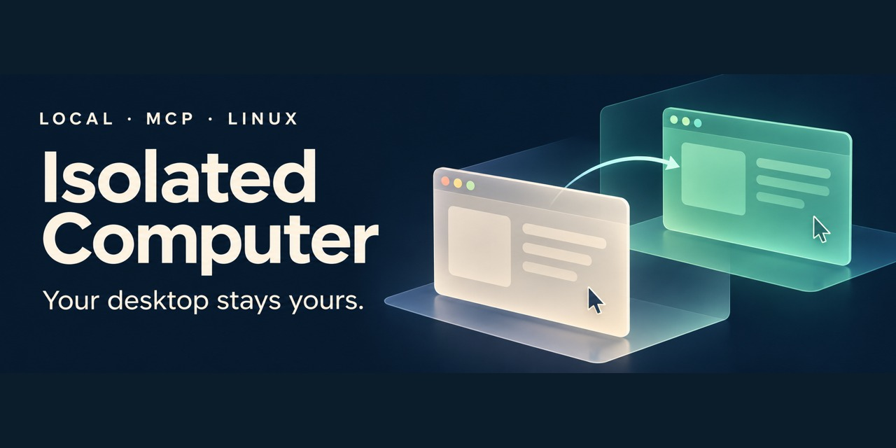

<h1 align="center">Arthur (Zichen) Zhu</h1>

  <strong>I build local-first AI tools that run on the hardware people already own.</strong> 
  First-year at UC Berkeley · agent tooling, on-device ML, native apps

  
  
  
  

---

## Shipped

### [Isolated Computer](https://github.com/zhuzccn-rgb/isolated-computer) — computer use that leaves your desktop alone

A local MCP server that lets an agent work in its own workspace while you keep yours. It drives apps through the accessibility tree first and falls back to screenshots, hands a live browser tab back and forth, and runs native Linux apps on an isolated display with separate input and a human-takeover control.

`Node.js` `MCP` `Browser extension (Chrome / Firefox)` `Linux`

[Code](https://github.com/zhuzccn-rgb/isolated-computer) · [v0.1.0 preview](https://github.com/zhuzccn-rgb/isolated-computer/releases/tag/v0.1.0) · [92-second demo](https://youtu.be/R6uM5N7hnG4) · [How it was verified](https://github.com/zhuzccn-rgb/isolated-computer/blob/main/VERIFY.md)

### [Askfor / 求索](https://github.com/zhuzccn-rgb/qiusuo) — a native Mac study archive

Record or import lectures, transcribe them on device, and keep notes, homework and mistakes in one searchable place. Written in SwiftUI on Apple's Speech frameworks, with no Electron shell and no always-on transcription server: the app bundle is about 5 MiB and idles near 18 MiB (measurement method in the README). English and Chinese.

`Swift` `SwiftUI` `On-device speech` `macOS 15+`

[Code](https://github.com/zhuzccn-rgb/qiusuo) · [Alpha download](https://github.com/zhuzccn-rgb/qiusuo/releases/tag/v0.1.0-alpha.1)

## In progress

### SEGMA — visual-event memory for smart glasses

A memory system built around one loop: `observe → record → refresh → expire → query`. Perception, world state and decision are separate modules, and I am writing the small decision model myself to learn how a local model can choose what to remember, update or ignore, and when to ask for more evidence. It currently runs as an offline prototype with a rule-based policy; the learned model is not trained yet. The repository is private while the design settles.

## Earlier prototypes

| Project | What it is |
| --- | --- |
| [AI-examiner](https://github.com/zhuzccn-rgb/AI-examiner) | A LangGraph workflow that reads question PDFs with OCR, indexes them, and assembles practice papers by topic and score. Experimental. |
| [Folio](https://github.com/zhuzccn-rgb/pdf2epub) | A local PDF-to-EPUB converter tuned for technical books, with a CLI and a small web interface. Prototype. |

## How I work

- **I say what was tested.** Each project keeps its verification notes and known limits next to the code.
- **I use AI coding tools heavily, and I say so.** I design the systems and workflows, then simplify and rewrite core modules by hand until I understand them.
- **I like constraints.** In high school I helped build a shared AI tutoring server out of repurposed hardware; I still prefer making things fit on the machine in front of me.

Currently taking CS 61A and MATH 52 at Berkeley.
